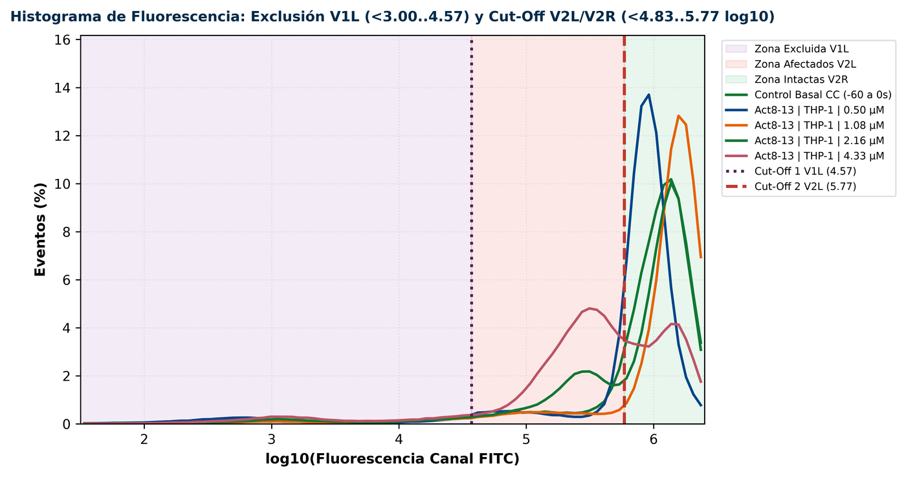
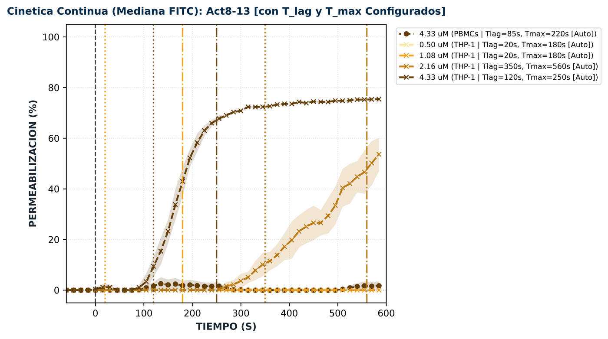
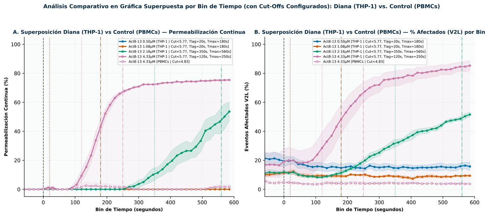
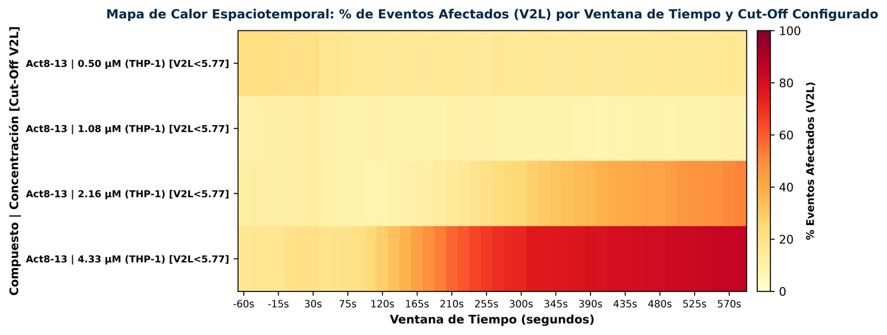
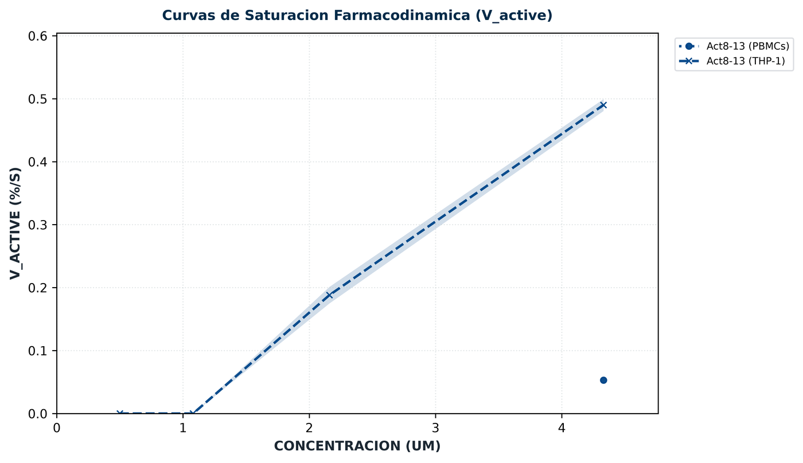
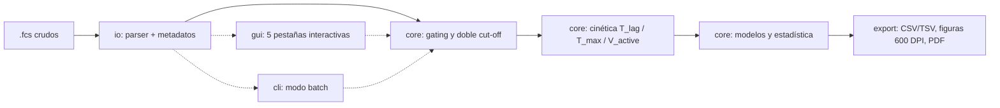

<div align="center">

# 🧬 Poralytix

**Análisis cinético de permeabilización de membrana por citometría de flujo (`.fcs`)**

*pore + analytics* — Cuantifica cuándo, cuánto y con qué selectividad un péptido abre poros en la membrana celular.


</div>

---

## 📌 ¿Qué es Poralytix?

Poralytix es una estación de trabajo científica para estudiar la **actividad citolítica de péptidos**
(p. ej. *Act8-13*, *Act8-20*, *Satanin 1*, *CZS5*) mediante ensayos cinéticos de **retención/fuga de
calceína (FITC)** adquiridos por citometría de flujo.

A partir de archivos `.fcs` crudos, Poralytix reconstruye la cinética evento a evento y responde
las preguntas clave del ensayo:

| Pregunta biológica | Cómo la responde Poralytix |
| :--- | :--- |
| **¿Cuándo empieza el daño?** | Detecta la latencia `T_lag` y el inicio de meseta `T_max` (automático o arrastrable). |
| **¿Qué tan rápido ocurre?** | Calcula la velocidad activa de permeabilización `V_active` (%/s) entre `T_lag` y `T_max`. |
| **¿Qué fracción de células se afecta?** | Clasifica cada evento con doble cut-off (V1L exclusión · V2L afectados · V2R intactas). |
| **¿Depende de la dosis?** | Ajusta modelos farmacodinámicos (Hill, Michaelis-Menten, Gompertz, Weibull, bi-exponencial) y EC50(t). |
| **¿Es selectivo?** | Contrasta la línea diana (p. ej. THP-1) frente al control sano (p. ej. PBMCs): ΔAUC, Odds Ratio, p y q-FDR. |
| **¿Qué mecanismo sugiere?** | Clasifica la respuesta (*Todo-o-Nada / poro bimodal* vs *Gradual / fuga parcial*) mediante bimodalidad, entropía e índice de sincronía. |

> [!NOTE]
> Poralytix es la **versión refactorizada y modular** (v2.0.0) del analizador original, que se conserva
> como script único en [`analizador-citometria`](https://github.com/gtellez5532UniHumboldt/analizador-citometria).

---

## 🔬 Resultados que produce

Ejemplo real de salida para **Act8-13** sobre **THP-1** (diana) y **PBMCs** (control sano),
dosis de 0.50 a 4.33 µM, ventana de −60 a 600 s y bins de 15 s.

### 1. Clasificación de eventos con doble cut-off

El histograma de fluorescencia separa los eventos excluidos (**V1L**), los afectados/permeabilizados
(**V2L**) y las células intactas (**V2R**). Los umbrales se arrastran con el ratón o se calibran
automáticamente contra el control basal (`CC`, −60 a 0 s).

<p align="center"></p>

### 2. Cinética continua con `T_lag` / `T_max`

<p align="center"></p>

### 3. Diana vs. control: selectividad

Superposición de la permeabilización continua (A) y del % de eventos afectados V2L (B) en THP-1 frente a PBMCs.

<p align="center"></p>

### 4. Mapa de calor espaciotemporal

<p align="center"></p>

### 5. Saturación farmacodinámica (`V_active` vs. concentración)

<p align="center"></p>

### Lectura de los resultados del ejemplo

| Indicador | Resultado (Act8-13) |
| :--- | :--- |
| Umbral de actividad en THP-1 | Sin efecto a 0.50–1.08 µM; lisis significativa desde **2.16 µM** |
| Permeabilización máxima (THP-1, 4.33 µM) | **~75 %** continua · **85 %** eventos V2L al final del ensayo |
| `T_lag` → `T_max` (4.33 µM) | **120 s → 250 s**, `V_active` = **0.49 %/s** |
| Modelo de Hill (THP-1) | `V_max` = 0.50 %/s · `K_d` = **2.35 µM** [2.27–2.46] · `n_H` = 6.0 · R² = 0.9999 |
| EC50 dependiente del tiempo | 3.31 µM a 300 s → 2.67 µM a 450 s (Cochran-Armitage, p < 0.0001) |
| Selectividad a 4.33 µM | ΔAUC THP-1 vs PBMCs = **+49.8 %** · OR = 149.7 · q < 0.0001 |
| Control sano (PBMCs, 4.33 µM) | Sin afectación (≈ 4–5 % V2L, comportamiento basal) |
| Mecanismo sugerido | **Todo-o-Nada (poro bimodal)**, con cooperatividad alta (`n_H` en el límite superior) |

> [!IMPORTANT]
> Estos valores ilustran la salida del software y corresponden a datos experimentales de laboratorio.
> Los archivos `.fcs` y las carpetas `Resultados_*` **no se versionan** en este repositorio.

### Archivos exportados por análisis

| Categoría | Contenido |
| :--- | :--- |
| **0 · Prerregistro** | Parámetros de pre-análisis, gates FSC/SSC y cut-offs configurados por muestra |
| **I · Categórico** | Hitos del efecto (T50, T_max, LT50, ΔT10-90), proporciones por ventana con IC 95 % Wilson, tendencias e isocronas EC50(t) |
| **II · Velocidades** | `V0` temprana, `V0` completa, `V_active` y moléculas de péptido por célula |
| **III · Morfología** | Cambios normalizados de FSC/SSC (tamaño y complejidad celular) |
| **IV · Modelos** | `V_max`, `K_d`, cooperatividad, eficiencia lítica, R² y R² ajustado |
| **V · Contrastes** | Selectividad diana vs control y contrastes dinámicos entre dosis (p y q-FDR) |
| **Figuras** | TIFF / PNG a **600 DPI** listas para publicación |
| **Reporte** | PDF auditable estructurado por categorías + tablas CSV/TSV + sesión `.json` reproducible |

---

## 🏗️ Arquitectura

```text
poralytix/
├── main.py                     # Punto de entrada de la interfaz gráfica (GUI)
├── cli.py                      # Procesamiento batch por línea de comandos (headless)
├── run_integrity_check.py      # Diagnóstico de entorno, estructura y pruebas
├── requirements.txt
├── cytoworkstation/            # Paquete principal
│   ├── config.py               # Alias de péptidos, paletas cromáticas, canales y constantes
│   ├── io/
│   │   ├── fcs_parser.py       # Parser binario FCS 2.0 / 3.0 / 3.1 sin dependencias externas
│   │   ├── metadata.py         # Deducción de compuesto, línea celular, dosis, réplica y rol
│   │   └── session.py          # Guardado / carga de sesiones .json
│   ├── core/
│   │   ├── kinetics.py         # Gating morfológico, doble cut-off, T_lag, T_max, V_active
│   │   ├── models.py           # Hill, Michaelis-Menten, Gompertz, Weibull, bi-exponencial
│   │   ├── statistics.py       # Wilson 95 %, h de Cohen, Cochran-Armitage, Fisher / χ²
│   │   └── synthetic_demo.py   # Generador determinista de .fcs sintéticos
│   ├── export/
│   │   ├── tables_export.py    # CSV / TSV
│   │   ├── plots_600dpi.py     # Figuras TIFF / PNG a 600 DPI
│   │   └── pdf_report.py       # Reporte PDF auditable
│   └── gui/
│       ├── app.py              # Controlador principal (5 pestañas)
│       ├── widgets/            # Lienzos interactivos: histograma, cinética, categórico, saturación
│       └── dialogs/            # Editor de muestras, ayuda matemática y guía de usuario
├── tests/                      # Pruebas unitarias e integración
└── docs/img/                   # Figuras de ejemplo para este README
```



---

## ⚙️ Instalación

Requiere **Python 3.11** (Windows x64 validado) con Tkinter.

```powershell
git clone https://github.com/gtellez5532UniHumboldt/poralytix.git
cd poralytix

py -3.11 -m venv .venv
.\.venv\Scripts\Activate.ps1
pip install -r requirements.txt

# Verificar entorno y estructura
py -3.11 run_integrity_check.py
```

Dependencias: `numpy`, `scipy`, `pandas`, `matplotlib`, `reportlab`.

---

## 🚀 Uso

### Interfaz gráfica

```powershell
py -3.11 main.py
```

| Pestaña | Función |
| :--- | :--- |
| **1 · Carga** | Subir `.fcs` (o generar set demo), revisar/editar metadatos en lote, definir línea diana, control y canal. |
| **2 · Pre-análisis** | Ajustar gates FSC/SSC, cut-offs V1L/V2L y ventanas `T_lag`/`T_max` arrastrando sobre las gráficas. |
| **3 · Panel categórico** | Afectados vs. no afectados por ventana, heatmap, Cochran-Armitage e isocronas EC50(t). |
| **4 · Modelos** | Ajuste del modelo farmacodinámico y guardado de sesión `.json` (Ctrl+S). |
| **5 · Exportación** | Reporte PDF, figuras 600 DPI y tablas CSV/TSV. |

### Modo batch (sin interfaz)

```powershell
py -3.11 cli.py --input-dir ..\CZS5c- --output-dir Resultados_CZS5c `
    --target-cell THP-1 --control-cell PBMCs --model "Allosteric Hill" `
    --v2l-cutoff 4.85 --v1l-excl 3.00
```

| Argumento | Por defecto | Descripción |
| :--- | :--- | :--- |
| `--input-dir`, `-i` | *(requerido)* | Carpeta con archivos `.fcs` (admite subcarpetas por línea celular) |
| `--output-dir`, `-o` | `Resultados_Exportados` | Carpeta de destino |
| `--target-cell` | `THP-1` | Línea celular diana |
| `--control-cell` | `PBMCs` | Línea celular sana de control |
| `--model` | `Allosteric Hill` | Modelo matemático a ajustar |
| `--v2l-cutoff` | `4.85` | Cut-off V2L (log10) |
| `--v1l-excl` | `3.00` | Cut-off de exclusión V1L (log10) |

### Convención de nombres de archivo

Los metadatos se deducen del nombre del archivo, por ejemplo:

| Archivo | Compuesto | Línea | Dosis | Rol | Réplica |
| :--- | :--- | :--- | :--- | :--- | :--- |
| `THP1-813-0.5-1.fcs` | Act8-13 | THP-1 | 0.5 µM | Experimental | R1 |
| `PBMCs-CC-sat1-5.7-3.fcs` | Satanin 1 | PBMCs | 5.7 µM | Control basal | R3 |
| `CZS5_THP1_9_CC_2.fcs` | CZS5 | THP-1 | 9 µM | Control basal | R2 |

---

## 📐 Modelos matemáticos

| Modelo | Ecuación |
| :--- | :--- |
| **Hill alostérico** (por defecto, `n_H` ∈ [0.5, 6]) | $V(C) = \dfrac{V_{max}\, C^{n_H}}{K_d^{n_H} + C^{n_H}}$ |
| **Michaelis-Menten** | $V(C) = \dfrac{V_{max}\, C}{K_d + C}$ |
| **Gompertz** | $V(C) = V_{max}\, e^{-e^{-k_G (C - K_d)}}$ |
| **Weibull** | $V(C) = V_{max}\left[1 - e^{-(C/K_d)^m}\right]$ |
| **Bi-exponencial temporal** | $P(t) = P_{ads}(1 - e^{-k_{ads} t}) + P_{lys}(1 - e^{-k_{lys}\max(0,\, t - T_{lag})})$ |

**Estadística:** IC 95 % de Wilson, prueba exacta de Fisher / χ², Odds Ratio y Riesgo Relativo,
h de Cohen, tendencia de Cochran-Armitage, corrección FDR (q) e índices de bimodalidad,
entropía y sincronía para la clasificación mecanística.

---

## 🧪 Pruebas

```powershell
# Desde la raíz del repositorio
py -3.11 -m unittest discover -s tests -t . -v
```

> [!WARNING]
> `tests/test_fcs_parser.py` y `tests/test_metadata.py` usan rutas absolutas a datasets
> experimentales locales; fallarán si esos `.fcs` no están disponibles en la máquina.

---

<div align="center">
<sub>Poralytix v2.0.0 · Laboratorio de Investigación en Péptidos y Membranas</sub>
</div>
