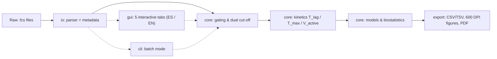

<div align="center">

# 🧬 Poralytix

**Kinetic Analysis of Cell Membrane Permeabilization via Flow Cytometry (`.fcs`)**

*pore + analytics* — Quantify when, how fast, and how selectively a peptide forms pores in cell membranes.

[](README_EN.md)
[](README.md)


</div>

---

## 📌 What is Poralytix?

Poralytix is a scientific workstation designed to study the **cytolytic activity of peptides**
(e.g., *Sample peptide*, *Act8-20*, *Satanin 1*, *CZS5*) using kinetic assays of **calcein (FITC) retention and leakage**
acquired via flow cytometry.

Starting from raw `.fcs` files, Poralytix reconstructs kinetics event-by-event, answering core biological questions:

| Biological Question | How Poralytix Answers It |
| :--- | :--- |
| **When does membrane damage start?** | Automatically detects latency `T_lag` and plateau onset `T_max` (also interactive on plots). |
| **How fast does permeabilization occur?** | Computes the active permeabilization rate `V_active` (%/s) between `T_lag` and `T_max`. |
| **What fraction of cells is affected?** | Categorizes every event via dual cut-offs (V1L exclusion · V2L affected · V2R intact). |
| **Is it dose-dependent?** | Fits pharmacodynamic models (Hill, Michaelis-Menten, Gompertz, Weibull, Bi-exponential) and computes time-dependent EC50(t). |
| **Is it selective?** | Directly contrasts target cells (e.g., THP-1) against healthy controls (e.g., PBMCs): ΔAUC, Odds Ratio, p-values, and q-FDR. |
| **What mechanism is suggested?** | Classifies response (*All-or-None / bimodal pore* vs *Gradual / graded leakage*) via bimodality coefficient, Shannon entropy, and synchrony index. |

> [!NOTE]
> Poralytix is the **modular, refactored version** (v2.0.0) of the original analyzer, which is preserved as a single-file script in [`analizador-citometria`](https://github.com/gtellez5532UniHumboldt/analizador-citometria).

---

## 🔬 Real Output & Visual Results

Real analysis example for **Sample peptide** tested on **THP-1** (target cell line) and **PBMCs** (healthy control),
tested at 0.50 to 4.33 µM, over a −60 to 600 s acquisition window with 15 s time bins.

### 1. Dual Cut-Off Event Classification

The fluorescence histogram separates excluded events (**V1L**), permeabilized/affected cells (**V2L**),
and intact cells (**V2R**). Thresholds can be adjusted interactively with the mouse or auto-calibrated
against baseline negative controls (`CC`, −60 to 0 s).

<p align="center"></p>

### 2. Continuous Permeabilization Kinetics (`T_lag` / `T_max`)

<p align="center"></p>

### 3. Target vs. Healthy Control: Cell Selectivity

Overlaid kinetics showing continuous permeabilization (A) and % affected V2L events (B) in THP-1 vs. PBMCs.

<p align="center"></p>

### 4. Spatiotemporal Heatmap

<p align="center"></p>

### 5. Pharmacodynamic Rate Saturation (`V_active` vs. Concentration)

<p align="center"></p>

### Summary of Example Findings

| Metric | Result (Sample peptide) |
| :--- | :--- |
| Target Activity Threshold (THP-1) | Inactive at 0.50–1.08 µM; significant lysis begins at **2.16 µM** |
| Maximum Permeabilization (THP-1, 4.33 µM) | **~75%** continuous · **85%** V2L affected events at endpoint |
| `T_lag` → `T_max` Window (4.33 µM) | **120 s → 250 s**, `V_active` = **0.49 %/s** |
| Allosteric Hill Model (THP-1) | `V_max` = 0.50 %/s · `K_d` = **2.35 µM** [2.27–2.46] · `n_H` = 6.0 · R² = 0.9999 |
| Time-Dependent EC50 | 3.31 µM at 300 s → 2.67 µM at 450 s (Cochran-Armitage trend, p < 0.0001) |
| Selectivity Contrast at 4.33 µM | ΔAUC THP-1 vs PBMCs = **+49.8%** · Odds Ratio = 149.7 · q < 0.0001 |
| Healthy Control (PBMCs, 4.33 µM) | Completely unperturbed (≈ 4–5% V2L baseline level) |
| Inferred Biophysical Mechanism | **All-or-None (bimodal pore formation)** with high positive cooperativity |

> [!IMPORTANT]
> These values illustrate standard pipeline outputs on experimental laboratory data.
> Raw `.fcs` datasets and generated `Resultados_*` folders are **excluded** via `.gitignore`.

### Exported Analysis Artifacts

| Category | Output Description |
| :--- | :--- |
| **0 · Pre-registration** | Pre-analysis settings, FSC/SSC morphological gates, sample-specific cut-offs |
| **I · Categorical** | Effect milestones (T50, T_max, LT50, ΔT10-90), proportions by time window with 95% Wilson CI, trend tests, EC50(t) |
| **II · Rates** | Early rate `V0`, full rate `V0`, active rate `V_active`, stoichiometric peptide molecules per cell |
| **III · Morphology** | Normalized FSC/SSC changes (cell volume and internal complexity changes) |
| **IV · Models** | Fitted parameters (`V_max`, `K_d`, cooperativity $n_H$, lytic efficiency, R², and adjusted R²) |
| **V · Contrasts** | Target vs. control selectivity and dose-dynamic contrasts with FDR adjustment (q-values) |
| **Figures** | Publication-ready **600 DPI** TIFF and PNG renders |
| **Report** | Fully audited PDF report organized by categories + CSV/TSV tables + JSON session file |

---

## 🏗️ Architecture

```text
poralytix/
├── main.py                     # GUI entry point with multilingual CLI flag
├── cli.py                      # Headless batch processing command-line tool
├── run_integrity_check.py      # Environment, structure, and test suite verification
├── requirements.txt
├── cytoworkstation/            # Core package
│   ├── config.py               # Peptide aliases, publication palettes, channels & constants
│   ├── i18n.py                 # Bilingual internationalization engine (Spanish / English)
│   ├── io/
│   │   ├── fcs_parser.py       # Zero-dependency binary FCS 2.0 / 3.0 / 3.1 parser
│   │   ├── metadata.py         # Automatic sample metadata deduction (compound, line, dose, rep)
│   │   └── session.py          # Session (.json) serialization & roundtrip restore
│   ├── core/
│   │   ├── kinetics.py         # Morphological gating, dual cut-offs, T_lag, T_max, V_active
│   │   ├── models.py           # Hill, Michaelis-Menten, Gompertz, Weibull, Bi-exponential
│   │   ├── statistics.py       # Wilson 95% CI, Cohen's h, Cochran-Armitage, Fisher / χ²
│   │   └── synthetic_demo.py   # Deterministic synthetic FCS generator for self-testing
│   ├── export/
│   │   ├── tables_export.py    # CSV / TSV tabular export
│   │   ├── plots_600dpi.py     # 600 DPI publication plots (TIFF / PNG)
│   │   └── pdf_report.py       # Comprehensive audited PDF report generator
│   └── gui/
│       ├── app.py              # Main GUI controller (5 interactive tabs)
│       ├── widgets/            # Interactive canvases: histogram, kinetics, categorical, saturation
│       └── dialogs/            # Sample editor, math formulas help, user guide
├── tests/                      # Unit & integration test suite (including i18n tests)
└── docs/img/                   # Anonymized demonstration figures for this documentation
```



---

## ⚙️ Installation

Requires **Python 3.11** (tested and validated on Windows x64) with Tkinter.

```powershell
git clone https://github.com/gtellez5532UniHumboldt/poralytix.git
cd poralytix

py -3.11 -m venv .venv
.\.venv\Scripts\Activate.ps1
pip install -r requirements.txt

# Run integrity check and tests
py -3.11 run_integrity_check.py
```

Dependencies: `numpy`, `scipy`, `pandas`, `matplotlib`, `reportlab`.

---

## 🚀 Usage

### Graphical User Interface (Bilingual English / Spanish)

```powershell
# Launch in English
py -3.11 main.py --lang en

# Launch in Spanish (default)
py -3.11 main.py
```

> [!TIP]
> You can switch dynamically between **English** and **Spanish** at any time using the `🌐 Language / Idioma` dropdown menu in the top bar or via the main menu.

| Tab | Purpose |
| :--- | :--- |
| **1 · Data Loading** | Import `.fcs` files (or generate synthetic demo data), batch edit metadata, configure target/control cell lines and fluorescence channel. |
| **2 · Pre-Analysis** | Tune FSC/SSC gates, drag V1L/V2L cut-offs on the histogram, and set `T_lag`/`T_max` kinetic windows. |
| **3 · Categorical Panel** | Analyze affected vs. unaffected cells per time window, view spatiotemporal heatmaps, and assess Cochran-Armitage trends. |
| **4 · Kinetic Models** | Fit non-linear pharmacodynamic models (Hill, Michaelis-Menten, etc.) and save session `.json` (Ctrl+S). |
| **5 · Export** | Generate audited PDF report, 600 DPI figures, and full CSV/TSV tables. |

### Headless Batch CLI Mode

Process an entire directory without launching the graphical interface:

```powershell
py -3.11 cli.py --input-dir ..\CZS5c- --output-dir Resultados_CZS5c `
    --target-cell THP-1 --control-cell PBMCs --model "Allosteric Hill" `
    --v2l-cutoff 4.85 --v1l-excl 3.00
```

| Argument | Default | Description |
| :--- | :--- | :--- |
| `--input-dir`, `-i` | *(required)* | Path to folder containing `.fcs` files (subfolders per cell line supported) |
| `--output-dir`, `-o` | `Resultados_Exportados` | Destination output directory |
| `--target-cell` | `THP-1` | Target cell line name |
| `--control-cell` | `PBMCs` | Healthy control cell line name |
| `--model` | `Allosteric Hill` | Mathematical model to fit |
| `--v2l-cutoff` | `4.85` | V2L threshold in log10 |
| `--v1l-excl` | `3.00` | V1L exclusion threshold in log10 |

### File Naming Convention

Metadata fields are deduced automatically from filenames:

| Filename | Compound | Cell Line | Dose | Role | Replicate |
| :--- | :--- | :--- | :--- | :--- | :--- |
| `THP1-sample_pep-0.5-1.fcs` | Sample peptide | THP-1 | 0.5 µM | Experimental | R1 |
| `PBMCs-CC-sat1-5.7-3.fcs` | Satanin 1 | PBMCs | 5.7 µM | Baseline Control | R3 |
| `CZS5_THP1_9_CC_2.fcs` | CZS5 | THP-1 | 9 µM | Baseline Control | R2 |

---

## 📐 Mathematical Models

| Model | Equation |
| :--- | :--- |
| **Regularized Allosteric Hill** (default, `n_H` ∈ [0.5, 6]) | $V(C) = \dfrac{V_{max}\, C^{n_H}}{K_d^{n_H} + C^{n_H}}$ |
| **Michaelis-Menten** | $V(C) = \dfrac{V_{max}\, C}{K_d + C}$ |
| **Asymmetric Gompertz** | $V(C) = V_{max}\, e^{-e^{-k_G (C - K_d)}}$ |
| **Stretched Exponential Weibull** | $V(C) = V_{max}\left[1 - e^{-(C/K_d)^m}\right]$ |
| **Sequential Bi-Exponential** | $P(t) = P_{ads}(1 - e^{-k_{ads} t}) + P_{lys}(1 - e^{-k_{lys}\max(0,\, t - T_{lag})})$ |

**Biostatistical methods:** 95% Wilson score intervals, Fisher's exact test / χ², Odds Ratio & Relative Risk,
Cohen's h, Cochran-Armitage trend test, Benjamini-Hochberg FDR correction (q-values),
and multimodal indices (bimodality coefficient, Shannon entropy, synchrony index) for mechanistic classification.

---

## 🧪 Testing

```powershell
# From repository root
py -3.11 -m unittest discover -s tests -t . -v
```

> [!WARNING]
> `tests/test_fcs_parser.py` and `tests/test_metadata.py` reference local test datasets
> and will skip or fail if raw files are not mounted on the target machine.

---

<div align="center">
<sub>Poralytix v2.0.0 · Laboratory of Peptide & Membrane Biophysics</sub>
</div>
